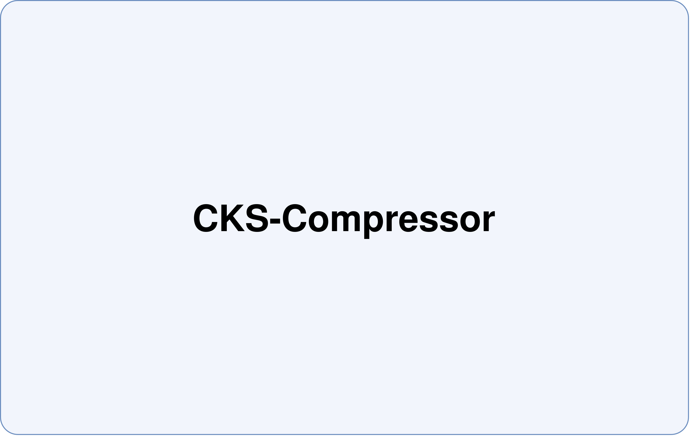

<div align="center">

# CKS Compressor

简体中文 | [English](./docs/README_en.md)

</div>

**CKS Compressor**: 是 CKS 面向 ZQ(NPU)系列芯片的模型压缩框架, 覆盖 CV 与 LM 两大场景, 可对浮点模型进行量化 / 稀疏化 / 剪枝 / 混合精度搜索等功能。并针对 ZQ 芯片所具备的低比特计算能力为该框架内相关功能模块做了特殊优化，最终通过推理引擎（cv: NNE, lm: vLLM-cks）实现了在 ZQ 芯片上的高效部署。

## 分层架构


> 待绘制更新...

## 核心特性

待更新...

## 安装

```bash
pip install -e .
```

## 快速开始

### CV 量化

```python
from compressor.quantization import run_cv_quantization

result = run_cv_quantization(
    model="resnet18",
    dataset_root="/path/to/imagefolder",  # 缺省可用 examples 的自建演示数据
    quant_mode="int8",
    output_path="out/resnet18.int8.onnx",
)
# result.export_path → QDQ ONNX; 同名 .manifest.json 为部署 sidecar
```

端到端样例执行命令:

```bash
# 1) torchvision 模型名 → 联网下载预训练权重后量化
# dataset缺省会使用默认的自建演示数据
python examples/cv_example.py --model resnet18

# 2) 本地 torch 模型文件(.pt/.pth, 完整模型 pickle)直接量化
python examples/cv_example.py --model /path/to/resnet18.pth --dataset /path/to/datasets/imagenet --quant-mode int8

# 3) 本地 ONNX 模型 → onnx2torch 转换后量化(需 pip install onnx2torch)
python examples/cv_example.py --model /path/to/resnet18.onnx --dataset /path/to/datasets/imagenet --quant-mode int8
```

### LM 量化

```python
from compressor.quantization import run_lm_compression

result = run_lm_compression(
    model="/path/to/Qwen3-0.6B",
    output_dir="out/qwen3-w8a8",
    recipe="quantize", # 算法名 / 自有 yaml / 原生配方 / None(默认)
)
# pipeline 内部: recipe 解析 → 硬件画像校验 → install(tu_mse + TU GPTQ backend) → Oneshot
```

```bash
python examples/llm_example.py --model /path/to/Qwen3-0.6B --algorithm quantize
python examples/llm_example.py --recipe examples/w8a8.yaml
```

### recipe 三种来源

```python
from compressor.quantization import load_recipe

# 1) 工程自有 yaml(声明式, 经 AlgorithmRegistry 翻译, 可静态校验)
load_recipe("examples/w8a8.yaml")
# 2) 算法名(注册表 + 项目默认参数)
run_lm_compression(..., recipe="gptq")
# 3) llmcompressor 原生配方(Modifier 列表 / 原生 yaml)原样透传
```

### 硬件画像校验

```python
from compressor.hardware import HardwareProfile, validate_recipe_for_profile

verdict = validate_recipe_for_profile(mapping, HardwareProfile())
verdict.errors    # 阻断项(scheme 不在白名单 / attention 激活非 FP8 等)
verdict.warnings  # 建议项(广覆盖 4bit 激活 / lm_head ignore 等)
```

## CLI

安装后使用 `cks-compressor`(或源码目录下 `python -m compressor`)。子命令按技术分组, 场景作二级子命令:

```bash
cks-compressor --help
```

### CV 量化

```bash
cks-compressor quantize cv \
    --model resnet18 \
    --dataset /path/to/imagefolder \
    --quant-mode int8 \
    --output tmp/resnet18.int8.onnx
```

### LM 量化

```bash
cks-compressor quantize lm \
    --model /path/to/Qwen3-0.6B \
    --recipe gptq \
    --output-dir tmp/Qwen3-0.6B.quantize \
    --num-calibration-samples 8 \
    --max-seq-length 128
```

### LM 2:4 稀疏(SparseGPT)

```bash
cks-compressor sparsify lm \
    --model /path/to/Qwen3-0.6B \
    --output-dir tmp/qwen-sparse
```

> `search` / `eval` 子命令为占位, 工作流尚未接入

## 环境注意事项

- **HF 网络被墙**: 首次下载数据集需 `HF_ENDPOINT=https://hf-mirror.com`;
  之后 adapter 内置 cache 优先策略(命中 `~/.cache/huggingface` 注入快照 revision, 全程离线)
- **已知上游缺陷**(llmcompressor 0.14.0.1 × transformers 5.x): GPTQ 的 sequential
  校准路径因 AST autowrap 失败暂不可用, `quantize`(W8A8) 路径已验证完整
- **ONNX 导出**: onnxsim 参考实现要求 DQ 算子 opset 19/21, 导出时传
  `options={"opset_version": 19, "simplify": True}`

## 目录结构

```text
compressor/
  adapter/        端口契约(CvCompressor/LmCompressor) + ModelOpt/llmcompressor 适配器
  quantization/   pipeline + recipe + scheme/QDQ(使用方入口)
  hardware/       硬件格式模型(TuFormat/RoundingMode/block size, formats.py) + recipe 白名单校验(profile.py)
  model/           模型解析与注册表(cv/hf/本地 ckpt loader)
  datasets/       校准数据(cv: imagefolder/coco/voc, lm: wikitext)
  algorithms/     算法注册表(名字 → Modifier 工厂)
  observer/       前向统计(tu_mse 网格搜索 observer)
  kernels/        TU 语义量化 kernel(reference: fp8/int/mx 真值 + zq_bridge 桥接 zqinfer)
  export/         QDQ ONNX 导出与 manifest
  sparsity/ prune/ search/ eval/ graph/   骨架(占位)
  cli/            命令行入口
```
